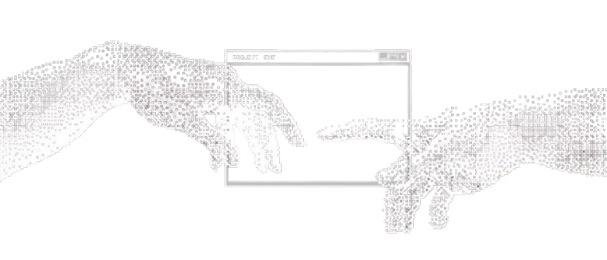
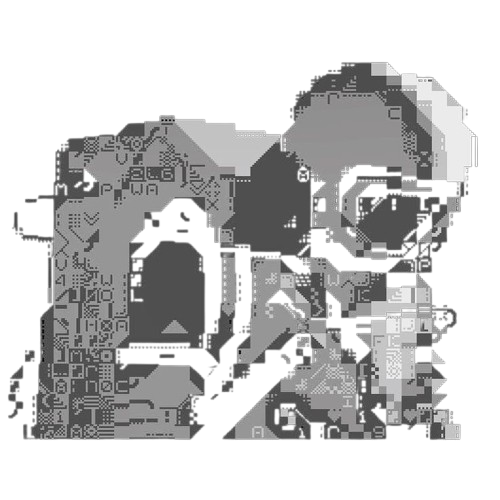

  

<h1 align="center">Hi 👋, I'm Caio Eduardo</h1>

<h3 align="center">Web & Mobile Developer</h3>

  

Desenvolvendo sistemas confiáveis e interfaces modernas com foco em performance e arquitetura limpa.

## <h2 align="center">🚀 About Me </h2>

**Caio Eduardo**, aqui — estudante de **Engenharia da Computação na UTFPR** focado em desenvolvimento **Web & Mobile**.

Gosto de construir aplicações escaláveis, interfaces modernas e sistemas de alta performance utilizando **ReactJS, TypeScript, Flutter, Python, .NET e C/C++**.

Atualmente, aprimorando minhas habilidades na construção de arquiteturas limpas, sistemas distribuídos e resolução de problemas complexos com **Estruturas de Dados & Algoritmos**.

Meu objetivo é simples: escrever código limpo, construir software confiável e evoluir como engenheiro criando sistemas que duram.

 

<h2 align="center">🤝 Connect</h2>

  
  &nbsp;&nbsp;&nbsp;
  

<h2 align="center">💻 Tech Stack</h2>

  

<h2 align="center">📊 GitHub Stats</h2>

<h2 align="center">📈 Activity Graph</h2>

  

### 
<h2 align="center">⌘ Commit Activity</h2>

<picture>
  <source media="(prefers-color-scheme: dark)"
    srcset="./assets/pacman-contribution-graph-dark.svg">

  <source media="(prefers-color-scheme: light)"
    srcset="./assets/pacman-contribution-graph.svg">

  

    
  

</picture>

<h2 align="center">⌘ Philosophy</h2>

  

